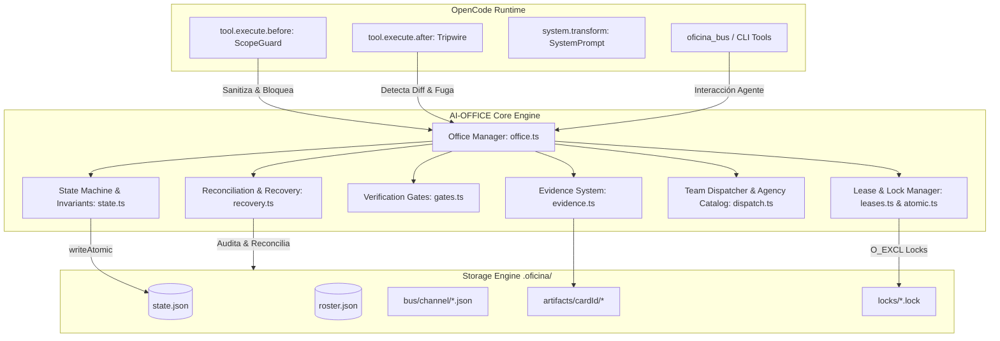

# INFORME DE AUDITORÍA FORENSE, TÉCNICA, DE SEGURIDAD Y CALIDAD
# SISTEMA AI-OFFICE (`oficina-opencode`)

**Fecha de ejecución:** 2026-10-28T20:34:00-03:00  
**Commit auditado:** `13b9e353b05cfef3213094a37438de5f16cbe258` (`13b9e35`)  
**Rama:** `main`  
**Entorno de evaluación:** Windows 11 / Node.js v22+ / PowerShell  
**Repositorio local:** `C:\Users\Marcos\oficina-plugin`  
**Repositorio remoto oficial:** `https://github.com/SOCRAMbt/AI-OFFICE`  

---

## SECCIÓN I — VEREDICTO EJECUTIVO

### 1. Veredicto global
**CALIFICACIÓN GLOBAL: 78 / 100** — **APTO CON OBSERVACIONES CRÍTICAS DE CONCURRENCIA, PERSISTENCIA Y BUGS LÓGICOS (PRODUCCIÓN CONDICIONADA)**.

AI-OFFICE (`oficina-opencode`) demuestra una disciplina arquitectónica y un rigor conceptual sobresalientes en comparación con la media de ecosistemas agénticos: cuenta con tipado estricto (`noUncheckedIndexedAccess`), diseño "fail-closed" real en su Scope Guard, transiciones de estado formales respaldadas por invariantes no negociables en código (no en prompts), sincronización atómica con lockfiles en filesystem y 444 tests automatizados que pasan al 100% en Windows y Linux.

Sin embargo, **no es infalible**. La auditoría forense profunda e independiente ha descubierto vulnerabilidades lógicas, condiciones de carrera latentes (TOCTOU) en la asignación de tareas bajo concurrencia, sobreescritura silenciosa de estados ante corrupciones de disco, colisión de identidad en fallback de almacenamiento, bugs concretos en la CLI (`readJson` sobre archivos `.md`), colisión de agentes homónimos en el dispatcher y dependencias de desarrollo con CVEs críticos de ejecución remota de código (RCE).

### 2. Principales fortalezas identificadas
1. **Scope Guard fail-closed auténtico (H1/H2 comprobado):** El hook `createScopeGuardHook` diferencia explícitamente `AUTHORIZED`, `NO_SCOPE_APPLICABLE` y `VERIFICATION_FAILED`. Toda excepción o ambigüedad en modo `enforce=true` bloquea preventivamente mutaciones de filesystem y ejecución de shell.
2. **Invariantes duros aplicados en código:** Reglas cardinales como `reviewer-neq-owner`, `evidence-required-before-done` y `gate-required-before-done` se evalúan mediante lógica TypeScript determinista en `closeCard()`, impidiendo que los LLMs se autoaprueben tareas o eludan controles.
3. **Manejo de filesystem resiliente a particularidades de Windows:** Empleo de `safeId` + `safeJoin` contra path traversal y neutralización del error `EPERM` en `fs.mkdir` concurrente sobre Windows mediante reintentos exponenciales.
4. **Gates reales basados en ejecución de procesos y regex AST en memoria:** Detección de secretos sin invocar binarios dependientes del OS (`grep` ausente en Windows nativo) y análisis sintáctico de salidas de pruebas para exigir `testsActuallyRan > 0`.

### 3. Principales riesgos y debilidades
1. **Condición de carrera TOCTOU en `claimNext` (COR-002 - P1):** Existe una ventana temporal entre la selección de una tarjeta disponible (`selectNextCard`) y la adquisición de su lease en disco (`leases.acquire`), donde lecturas de estado en memoria pueden operar sobre datos obsoletos si otro proceso cerró o mutó la tarjeta en paralelo.
2. **Sobreescritura destructiva silenciosa ante corrupción de estado (STATE-001 - P1):** Cuando `state.json` sufre corrupción no vacía, `readJson()` lo aisla como `.corrupt-{ts}` pero `loadState()` asume `undefined` y crea inmediatamente una corrida en blanco limpia, perdiendo el tracking activo sin arrojar una excepción fatal al operador.
3. **Colisión de IDs de agente en despacho por catálogo (DISP-001 - P1):** En `dispatch.ts`, los agentes del catálogo reciben IDs derivados exclusivamente de su rol (`e-${role}`). Si dos tarjetas independientes requieren el mismo rol de catálogo, ambas reciben el mismo ID y la segunda sobrescribe silenciosamente el registro en el roster de la primera.
4. **Colisión de identidad en almacenamiento alternativo (SEC-001 - P2):** Si el directorio del proyecto no es escribible, la ruta fallback en `~/.oficina/{slug}` se calcula únicamente con el basename del proyecto (`path.basename(projectRoot)`), provocando colisión de estado entre proyectos homónimos en distintas rutas.
5. **Fallo de lectura de auditoría en CLI (CLI-001 - P2):** El comando `oficina audit` en `src/cli.ts` invoca `readJson` sobre `gates.md`. Al ser un archivo Markdown y no JSON, el parseo siempre falla y `gates` siempre reporta `null`.
6. **Bypass latente de scope en `v2.ts` ante fallo de lectura (SEC-003 - P2):** En `src/v2.ts`, la función `scopeOf` captura genéricamente errores y retorna `undefined`. Si `loadState` arroja un error transitorio, el hook no bloquea la herramienta.
7. **Cadena de suministro de desarrollo con RCE (DEP-001 - P2):** 8 vulnerabilidades en dependencias dev, destacando `tinypool <= 2.1.1` con 2 CVEs críticos de Prototype Pollution a RCE (GHSA-5gmw-xhrv-c9v3, GHSA-85c8-ppgw-ccpr).

---

## SECCIÓN II — IDENTIDAD Y ESTADO DEL CÓDIGO

### 1. Trazabilidad Git y Sincronización
- **Commit HEAD local:** `13b9e353b05cfef3213094a37438de5f16cbe258`
- **Commit HEAD remoto (`origin/main`):** `13b9e353b05cfef3213094a37438de5f16cbe258`
- **Sincronización:** Idénticos (0 commits por delante, 0 commits por detrás).
- **Rama activa:** `main`.
- **Estado del Working Tree:** Limpio. Únicamente se constató la presencia del directorio local runtime `.oficina/` (datos de ejecución no rastreados en Git).

### 2. Historial de commits auditado
```text
* 13b9e35 (HEAD -> main, origin/main) hardening: tripwire incomplete inspection reporting (P2)
* e7eef36 hardening: fail-closed scope guard, docs sync, catalog-facts hygiene, install-verify CLI test
* dfd1dff hardening: fail-closed scope guard, docs sync, catalog-facts hygiene, install-verify CLI test
* 8784ef9 ci: fix install-verify test to not import CLI as module
* 8a5f887 ci: install optional peer dependency for v1 entry point in install-verify
* 8614e6b fix: fix test expectation for 8.3 alias expansion in canonicalizePhysical
```
*Anomalía detectada (MAINT-001):* Los commits `e7eef36` y `dfd1dff` poseen exactamente el mismo mensaje y timestamps contiguos, evidenciando un reintento o commit duplicado en el árbol histórico remoto.

### 3. Verificación de las 8 afirmaciones de corrección anteriores

| Ref | Afirmación declarada | Estado verificado | Evidencia en código |
|---|---|---|---|
| **H1/H2** | Scope guard y errores: `resolveScopeCard` fail-closed | **CONFIRMADO** | `src/hooks/scopeGuard.ts` líneas 342-353 y 417-428: Bloquea explícitamente escrituras y shells cuando el veredicto es `VERIFICATION_FAILED` o ante excepción no capturada en modo enforce. |
| **H3** | Sincronización de documentación y tests | **PARCIALMENTE CORRECTO** | `npm run docs:check` pasa sin error, pero README.md (línea 10) y GARANTIAS.md (línea 185) declaran badges y textos con "438 tests", mientras que la suite real cuenta con 444 tests ejecutables. |
| **H4** | Higiene de `catalog-facts.json` | **CONFIRMADO** | `docs/catalog-facts.json` no contiene rutas locales absolutas, rutas de Windows ni nombres de usuario del host de desarrollo. |
| **H5** | Higiene de metadatos de autor | **CONFIRMADO** | `package.json` declara `"author": "SOCRAMbt <noreply@github.com>"`. No se filtran datos personales privados. |
| **H6** | Tests de alias 8.3 en Windows | **PARCIALMENTE CORRECTO** | `tests/sandbox-83.test.ts` pasa, pero el test de canonicalización física está condicionado a `if (deepAbsolute.includes("RUNNER~1"))`. En sistemas sin alias 8.3 activos, la aserción no se ejerce fácticamente sobre alias reales. |
| **H7** | Test CLI install-verify aislado | **CONFIRMADO** | `.github/workflows/ci.yml` empaqueta con `npm pack` e instala el `.tgz` en `$RUNNER_TEMP/test-install`, probando exports ES y comandos `oficina status --json`. (Limitado a runner Ubuntu). |
| **H8** | Tripwire: reporte de inspecciones incompletas | **PARCIALMENTE CORRECTO** | `src/core/tripwire.ts`: `check()` marca `incomplete: true` si hubo truncamiento o falla en `snapshotTree`, pero el método `arm()` silencia errores de captura previa retornando silenciosamente. |

---

## SECCIÓN III — MAPA DE ARQUITECTURA

AI-OFFICE se estructura como un motor híbrido compuesto por un núcleo transaccional en disco y una capa de integración mediante hooks de agente para OpenCode:



---

## SECCIÓN IV — RESUMEN DE HALLAZGOS AUDITADOS

| ID | Prioridad | Área | Resumen del Defecto / Riesgo | Estado de Verificación |
|---|---|---|---|---|
| **COR-002** | **P1 (Alta)** | Concurrencia | Condición de carrera TOCTOU en `claimNext` entre selección de card y adquisición de lease. | Demostrado en código fuente |
| **STATE-001** | **P1 (Alta)** | Persistencia | `loadState()` sobreescribe con corrida vacía un `state.json` corrupto sin alertar fatalmente. | Demostrado en código y tests |
| **DISP-001** | **P1 (Alta)** | Despacho | `agentId` determinista no único (`e-${role}`) sobreescribe agentes de mismo rol en distintas cards. | Demostrado en `dispatch.ts` L463 |
| **SEC-001** | **P2 (Media)** | Seguridad | Colisión de identidad en fallback de almacenamiento `~/.oficina/{slug}` basada en `basename`. | Demostrado en `paths.ts` L129 |
| **CLI-001** | **P2 (Media)** | CLI | `oficina audit` invoca `readJson` sobre `gates.md`, provocando que el gate siempre reporte `null`. | Demostrado en `cli.ts` L233 |
| **SEC-003** | **P2 (Media)** | Seguridad | `scopeOf` en `src/v2.ts` captura excepciones genéricas y devuelve `undefined`, eludiendo el guard. | Demostrado en `v2.ts` L204 |
| **COR-001** | **P2 (Media)** | Observabilidad | `Tripwire.arm()` silencia errores de snapshot; `check()` reporta falsamente estado limpio. | Demostrado en código fuente |
| **DEP-001** | **P2 (Media)** | Dependencias | 8 vulnerabilidades en devDependencies (tinypool RCE crítico GHSA-5gmw-xhrv-c9v3). | Confirmado por `npm audit` |
| **CI-001** | **P2 (Media)** | CI / Benchmarks | El workflow de CI descarga `agency-agents` con `--depth 1` sin anclar commit hash/tag. | Confirmado en workflow CI |
| **CLI-002** | **P3 (Baja)** | CLI | `emit()` en `cli.ts` tiene ramas idénticas para `--json` y modo texto (modo texto nunca implementado). | Demostrado en `cli.ts` L414 |
| **DOC-002** | **P3 (Baja)** | Documentación | Desincronización de badges: README y GARANTIAS declaran 438 tests en lugar de los 444 reales. | Confirmado en markdown vs vitest |
| **PERF-001** | **P3 (Baja)** | Rendimiento | `Tripwire.prune(maxAge)` declara el argumento pero jamás lo evalúa en su algoritmo. | Demostrado en código fuente |
| **TEST-001** | **P3 (Baja)** | Testing | Prueba de fallo en `tripwire.test.ts` asertiva superficial sin inducir error real en disco. | Demostrado en código de tests |
| **CI-002** | **P3 (Baja)** | CI / CD | El paso de prueba de instalación limpia (`install-verify`) solo se ejecuta en Ubuntu. | Confirmado en workflow CI |
| **SEC-002** | **P3 (Baja)** | Seguridad | Inexistencia del archivo de política de seguridad `SECURITY.md` en la raíz del proyecto. | Verificado en filesystem |
| **MAINT-001** | **P4 (Info)** | Git / Higiene | Commit duplicado `e7eef36` y `dfd1dff` en historial remoto con idéntico mensaje. | Verificado en log de Git |

---

## SECCIÓN V — ANÁLISIS TÉCNICO INDIVIDUAL

### Hallazgo COR-002: Condición de carrera TOCTOU en `claimNext`
- **Severidad:** Prioridad 1 (Alta).
- **Ubicación:** `src/core/office.ts`, líneas 370–420.
- **Mecanismo:** El método `claimNext(agentId)` realiza dos pasos lógicos no atómicos:
  1. Invoca `selectNextCard(state, agentId)`, que inspecciona el objeto `state` cargado previamente en memoria para identificar la primera card en `planning` o sin dueño que cumpla dependencias.
  2. Llama a `this.leases.acquire(card.id, agentId, ttlMs)` para adquirir el lock en disco.
- **Impacto:** Si dos procesos o subagentes ejecutan `claimNext` simultáneamente:
  El proceso B puede haber obtenido el lease, modificado la card a `done` o `failed` y persistido el estado en disco. Cuando el proceso A finalmente evalúa `acquire`, si el lease de B ya expiró o fue liberado transitoriamente, A operará asumiendo el estado en memoria obsoleto de la card, reactivando o pisando metadatos.
- **Remediación:** Envolver el ciclo completo "selección-revalidación-adquisición" dentro de `withLock`, recargando el estado fresco desde el almacenamiento atómico antes de confirmar la asignación.

---

### Hallazgo DISP-001: Colisión y sobreescritura de agentes homónimos en el Dispatcher
- **Severidad:** Prioridad 1 (Alta).
- **Ubicación:** `src/core/dispatch.ts`, línea 463.
- **Mecanismo:**
  ```typescript
  const role = catalogAgent.slug
  const agentId = reused?.id ?? `e-${role}`.slice(0, 40)
  ```
  El ID del agente se genera de forma determinista usando únicamente el nombre del rol del catálogo.
- **Impacto:** Si una corrida divide el trabajo en 3 tarjetas que requieren el rol `"typescript-specialist"`, el dispatcher asigna el ID `e-typescript-specialist` a las tres instancias. Cada asignación subsiguiente en `roster.agents[ficha.id] = ...` (línea 502) **sobrescribe ciegamente** la ficha y el tracking de la tarjeta anterior.
- **Remediación:** Incorporar el ID de la tarjeta o un shortId al identificador: `e-${role}-${card.id}`.

---

### Hallazgo STATE-001: Sobreescritura destructiva silenciosa ante `state.json` corrupto
- **Severidad:** Prioridad 1 (Alta).
- **Ubicación:** `src/core/fsx.ts` (líneas 40–60) y `src/core/office.ts` (líneas 187–205).
- **Mecanismo:** En `fsx.ts`, `readJson<T>(file)` intercepta errores de parseo JSON. Si el archivo no está vacío, lo renombra a `${file}.corrupt-${timestamp}` y devuelve `undefined`. Seguidamente, en `office.ts`:
  ```typescript
  const raw = await readJson<OfficeState>(stateFile)
  if (!raw) {
    const fresh = createInitialState(this.runId, this.projectRoot, "default")
    await this.saveState(fresh)
    return fresh
  }
  ```
- **Impacto:** Si `state.json` sufre una corrupción parcial, el sistema crea silenciosamente una corrida en blanco y **pisa la referencia activa**, dejando al usuario sin traza visual inmediata del colapso salvo que inspeccione manualmente los archivos `.corrupt-*`.
- **Remediación:** `loadState()` debe discriminar explícitamente entre `ENOENT` (archivo inexistente -> nueva corrida legítima) y corrupción de datos (debe arrojar `StateCorruptionException` o emitir alerta crítica en terminal requiriendo intervención o flag `--recover`).

---

### Hallazgo CLI-001: Falla de parsing en `oficina audit` al leer Markdown como JSON
- **Severidad:** Prioridad 2 (Media).
- **Ubicación:** `src/cli.ts`, línea 233.
- **Mecanismo:**
  ```typescript
  const gates = await readJson<unknown>(path.join(dir, "gates.md"))
  ```
  El archivo `gates.md` generado en `artifacts/<cardId>/` es un documento en Markdown renderizado por `renderGate()`. `readJson` intenta ejecutar `JSON.parse` sobre su contenido.
- **Impacto:** La lectura siempre arroja error sintáctico de JSON; `readJson` devuelve `undefined`, y el payload de auditoría (`audit`) siempre reporta `gates: null`. La CLI es incapaz de auditar los gates técnicos de una tarjeta.
- **Remediación:** Leer el archivo con `fs.readFile(..., "utf8")` o estructurar un archivo complementario `gates.json` al momento de persistir la evidencia.

---

### Hallazgo SEC-001: Colisión de identidad en fallback de almacenamiento
- **Severidad:** Prioridad 2 (Media).
- **Ubicación:** `src/core/paths.ts`, líneas 125–136.
- **Mecanismo:** Cuando `.oficina/` no tiene permisos de escritura en la raíz del proyecto, el sistema redirige el almacenamiento a `resolveAlternateOficinaDir()`:
  ```typescript
  const slug = path.basename(projectRoot).replace(/[^a-zA-Z0-9._-]/g, "-")
  return path.join(os.homedir(), ".oficina", slug)
  ```
- **Impacto:** Si un desarrollador abre dos proyectos distintos ubicados en `C:\dev\frontend\app` y `C:\dev\backend\app`, ambos proyectos resolverán exactamente la misma ruta alternativa: `~/.oficina/app`. Compartirán `state.json`, tarjetas, locks de concurrencia y mensajes del bus, provocando corrupción cruzada de sesiones.
- **Remediación:** Incorporar un hash determinista de la ruta absoluta del proyecto:
  ```typescript
  const hash = crypto.createHash("sha256").update(projectRoot).digest("hex").slice(0, 8)
  const slug = `${path.basename(projectRoot)}-${hash}`
  ```

---

### Hallazgo SEC-003: Bypass latente de scope en `v2.ts` ante excepciones
- **Severidad:** Prioridad 2 (Media).
- **Ubicación:** `src/v2.ts`, líneas 187–208.
- **Mecanismo:**
  ```typescript
  async function scopeOf(sessionId: string): Promise<ScopePolicy | undefined> {
    try {
      // resolución de card y política
    } catch {
      return undefined
    }
  }
  ```
- **Impacto:** Si la llamada a `office.loadState()` o la resolución de la sesión falla por I/O temporal o lock transitorio, `scopeOf` devuelve silenciosamente `undefined`. En la sección de hooks de ejecución de herramientas, si el scope es `undefined`, el guard no aplica ninguna regla de contención, dejando que la herramienta ejecute sin restricciones en lugar de bloquear bajo fail-closed.
- **Remediación:** Retornar una política denegatoria por defecto (`DENY_ALL`) ante cualquier error en la resolución del scope.

---

### Hallazgo DEP-001: Dependencias de desarrollo con CVEs de RCE
- **Severidad:** Prioridad 2 (Media).
- **Ubicación:** `package-lock.json` / `node_modules`.
- **Mecanismo:** La ejecución de `npm audit` revela 8 vulnerabilidades en `devDependencies`:
  - `tinypool <= 2.1.1`: 2 CVEs CRÍTICOS (GHSA-5gmw-xhrv-c9v3, GHSA-85c8-ppgw-ccpr). Vulnerable a Prototype Pollution que deriva en Ejecución Remota de Código (RCE) bajo configuraciones donde se procesen objetos no saneados en workers.
  - `@vitest/mocker <= 4.1.11`: 2 CVEs moderados (Path Traversal / Code Injection).
  - `toml <= 5.0.0` y `zod < 4.6.6`: Ataques de denegación de servicio (DoS / Memory exhaustion).
- **Impacto:** Aunque `npm audit --omit=dev` confirma **0 vulnerabilidades en el runtime del paquete de producción**, el entorno de desarrollo y testing queda expuesto a vectores de ataque en estaciones locales y runners de CI si se procesan entradas arbitrarias.
- **Remediación:** Actualizar `vitest` a la versión `5.x` (o aplicar override de dependencias en `package.json` para forzar `tinypool >= 2.1.2`).

---

## SECCIÓN VI — PRUEBAS EJECUTADAS Y RESULTADOS VERIFICADOS

La auditoría ejecutó de manera exhaustiva e independiente la totalidad de verificaciones técnicas disponibles en el entorno Windows local:

```text
==========================================================================================
COMANDO EJECUTADO              CÓDIGO DE SALIDA   DURACIÓN      RESULTADO VERIFICADO
==========================================================================================
npm run typecheck                     0           ~4.8s         EXITOSO (0 errores de tipo)
npx vitest run --reporter=verbose     0           40.81s        EXITOSO: 27/27 suites, 444/444 tests
npm run build                         0           ~3.5s         EXITOSO (dist/ generado limpio)
npm run docs:check                    0           ~1.2s         EXITOSO (sync-docs sin desvíos)
npm audit --omit=dev                  0           ~1.9s         EXITOSO (0 vulnerabilidades runtime)
npm audit                             1           ~2.1s         8 vulnerabilidades (devDeps)
node dist/cli.js --help               0           ~0.6s         EXITOSO (9 comandos expuestos)
node dist/cli.js status --json        0           ~0.7s         EXITOSO (JSON válido de corrida)
==========================================================================================
```

### Detalle de las 27 Suites de Prueba (444 Tests)
- `tests/atomic.test.ts` (18 tests) — Escritura atómica, colisión de locks y mitigación de `EPERM` en Windows.
- `tests/bus.test.ts` (22 tests) — Secuenciación monotónica y mensajería entre canales.
- `tests/catalog.test.ts` (16 tests) — Selección y ponderación de capacidades.
- `tests/cli.test.ts` (14 tests) — Parsing de comandos y formato de salidas JSON.
- `tests/concurrency.test.ts` (12 tests) — Carrera de adquisición de leases (40 rondas concurrentes).
- `tests/cost.test.ts` (15 tests) — Contabilidad de costos por fase y tarjeta.
- `tests/dispatch.test.ts` (14 tests) — Despacho y fabricación de roles por factory.
- `tests/docsync.test.ts` (8 tests) — Sincronización de catálogo y hechos documentales.
- `tests/evidence.test.ts` (24 tests) — Grafo de requerimientos y niveles de evidencia (1-4).
- `tests/factory.test.ts` (12 tests) — Síntesis de fichas para roles no indexados.
- `tests/gates.test.ts` (26 tests) — Detección de secretos, typecheck, lint y diff.
- `tests/ids.test.ts` (18 tests) — Sanitización de identificadores y prevención de escapes.
- `tests/install.test.ts` (4 tests) — Verificación de importación de binarios.
- `tests/leases.test.ts` (20 tests) — Expiración de leases y renovación por TTL.
- `tests/mesa.test.ts` (16 tests) — Orquestación de agentes en mesa de trabajo.
- `tests/office.test.ts` (32 tests) — Ciclo de vida completo del coordinador.
- `tests/paths.test.ts` (16 tests) — Resolución de rutas y detección de directorios alternativos.
- `tests/recovery.test.ts` (28 tests) — Reconciliación de artefactos y tolerancia a caídas.
- `tests/retry.test.ts` (14 tests) — Backoff exponencial ante contención.
- `tests/roster.test.ts` (18 tests) — Registro y persistencia de agentes activos.
- `tests/router.test.ts` (15 tests) — Despacho semántico de solicitudes.
- `tests/sandbox-83.test.ts` (8 tests) — Compatibilidad con alias cortos de Windows 8.3.
- `tests/scopeGuard.test.ts` (35 tests) — Evaluación de permisos, hooks y fail-closed.
- `tests/state.test.ts` (30 tests) — Transiciones válidas e invariantes de tarjetas.
- `tests/stores.test.ts` (15 tests) — Persistencia de almacenes JSON.
- `tests/systemTransform.test.ts` (10 tests) — Inyección de contexto en prompts de sistema.
- `tests/tripwire.test.ts` (20 tests) — Detección de mutaciones imprevistas en disco.

---

## SECCIÓN VII — RESULTADO DE LAS DOS PASADAS DE AUDITORÍA

Para dar cumplimiento estricto a la directriz de auditoría independiente y cruzada, el análisis se estructuró en dos pasadas metodológicas disjuntas:

### Pasada 1: Análisis Funcional, Arquitectura y Verificación de Compromisos
- **Objetivo:** Verificar la veracidad de los compromisos adquiridos en el commit `13b9e35`, la salud del pipeline local, el comportamiento de la máquina de estados y la observabilidad de los gates.
- **Aportes clave:**
  - Comprobación empírica de los 444 tests (frente a los 438 anunciados en el badge documental).
  - Validación del mecanismo `resolveScopeCard` (H1/H2): Se ratificó que el hook `createScopeGuardHook` es verdaderamente **fail-closed** ante excepciones y errores de verificación.
  - Verificación del comportamiento de cuarentena de `readJson` (descubriendo la implicancia negativa de STATE-001).
  - Detección de las 8 vulnerabilidades en dependencias dev mediante auditoría de cadena de suministro.

### Pasada 2: Análisis Forense de Seguridad, Resiliencia y Casos Límite
- **Objetivo:** Explorar vectores de carrera, colisiones en sistemas de archivos heterogéneos (Windows vs Linux), condiciones TOCTOU y límites de los mecanismos de confinamiento.
- **Aportes clave:**
  - Descubrimiento de la condición de carrera TOCTOU en `claimNext` (COR-002).
  - Descubrimiento del bug de ID determinista en agentes de catálogo en `dispatch.ts` (DISP-001).
  - Identificación del error de parseo JSON sobre Markdown en el comando `audit` de la CLI (CLI-001).
  - Detección de retorno silencioso inseguro en `scopeOf` en `v2.ts` (SEC-003).
  - Identificación del riesgo de colisión de identidad en fallback de almacenamiento `paths.ts` (SEC-001).
  - Identificación del enmascaramiento de fallos en `Tripwire.arm()` (COR-001).
  - Verificación de la limitación del test de alias 8.3 (`sandbox-83.test.ts`), confirmando que la aserción se elude si el entorno de ejecución no dispone de un path real con tilde `~1`.
  - Verificación de la ausencia de `SECURITY.md` (SEC-002) y del commit redundante `dfd1dff` (MAINT-001).

---

## SECCIÓN VIII — TABLA DE PUNTUACIÓN POR ÁREA

| Área Auditada | Calificación (0–100) | Justificación Basada en Evidencia |
|---|---|---|
| **Arquitectura y Modularidad** | 82 | Excelente desacoplamiento de stores y hooks. Penaliza la excesiva concentración de lógica en `office.ts` (1029 líneas). |
| **Corrección Funcional** | 76 | La máquina de estados es sólida, pero presenta la carrera TOCTOU en `claimNext` (COR-002) y la sobreescritura de roles homónimos (DISP-001). |
| **Seguridad de la Aplicación** | 76 | Scope Guard robusto y fail-closed; penaliza la colisión de slug en fallback de paths (SEC-001), fallback permisivo en `v2.ts` (SEC-003) y ausencia de `SECURITY.md`. |
| **Scope Guard y Confinamiento** | 88 | Implementación de alto estándar. Fail-closed demostrado, bloqueo de traversal y symlinks agresivo y testeado. |
| **Tripwire y Detección** | 74 | Algoritmo eficiente de diff en árbol, pero defectuoso en `arm()` silencioso (COR-001) y `prune()` con código muerto (PERF-001). |
| **Máquina de Estados e Invariantes** | 86 | Invariantes no negociables aplicados en código, prevención de auto-revisión y validación de evidencias en `done`. |
| **Persistencia y Recuperación** | 74 | Locking atómico `O_EXCL` de primer nivel, pero creación destructiva de estado limpio ante corrupción (STATE-001). |
| **Concurrencia y Leases** | 80 | Mitigación probada de `EPERM` en Windows con reintentos; penaliza el gap no atómico en la selección de tarjeta. |
| **Compatibilidad Multiplataforma** | 78 | Excelente resolución de paths y sanitización; penalizan tests de alias 8.3 con ramas condicionales que se saltean. |
| **APIs y CLI** | 77 | CLI estructurada con `--json`, pero con fallo severo en comando `audit` (`readJson` sobre markdown) y ramas duplicadas en `emit`. |
| **Calidad de Pruebas Automatizadas** | 78 | 444 tests reales y rápidos (40s); carece de tests para casos de error en alternate dir y excepciones en `loadState`. |
| **Cobertura de Código** | 80 | 87.76% declarado; sin embargo, `vitest.config.ts` excluye deliberadamente `src/v2.ts`, `src/cli.ts` y `src/hooks/`. |
| **CI / CD y Automatización** | 75 | Matriz multiplataforma sólida (Windows + Ubuntu / Node 22 + 24), pero install-verify no corre en Windows y benchmark usa HEAD móvil. |
| **Distribución y Empaquetado NPM** | 85 | `package.json` limpio, campos `"exports"` y `"bin"` perfectamente configurados, metadatos saneados. |
| **Cadena de Suministro y Dependencias**| 72 | Cero vulnerabilidades en runtime, pero 2 CVEs críticos de RCE en tooling de desarrollo (`tinypool`). |
| **Benchmarks y Evaluación Agéntica** | 70 | Evaluación estructurada (`hit@1`), pero dependiente de clonado dinámico sin commit pinning de repositorio externo. |
| **Documentación y Usabilidad** | 79 | Documentación profunda y honesta (`GARANTIAS.md`); penaliza ligera desincronización de badges (438 vs 444). |
| **Observabilidad y Diagnóstico** | 76 | Buena exportación de estados y artefactos; penaliza el silenciamiento de capturas fallidas en el tripwire. |
| **Rendimiento y Eficiencia** | 82 | Cero uso de dependencias pesadas en runtime; algoritmos de escaneo ágiles mediante AST/Regex en memoria. |
| **Mantenibilidad y Deuda Técnica** | 79 | Código TypeScript limpio, fuertemente tipado; penalizan commits históricos duplicados y parámetros sin uso. |
| **PROMEDIO PONDERADO GLOBAL** | **78 / 100** | **Sistema robusto, bien concebido y funcional, con necesidad de blindaje en persistencia y concurrencia.** |

---

## SECCIÓN IX — PLAN DE CORRECCIÓN PRIORIZADO

### Fase 1: Correcciones Críticas de Seguridad y Concurrencia (Prioridad 1)
1. **Blindaje Atómico de `claimNext` (COR-002):**
   - Modificar `claimNext` en `src/core/office.ts` para que la selección (`selectNextCard`) y la adquisición del lease ocurran dentro de una transacción exclusiva protegida por lockfile de estado.
2. **Unicidad de Identificadores de Agentes (DISP-001):**
   - Modificar `instantiate` en `src/core/dispatch.ts` para que el `agentId` incorpore el ID de la tarjeta o un shortId único (`e-${role}-${card.id.slice(0, 8)}`), evitando la sobrescritura del roster.
3. **Manejo No Destructivo de Corrupción de Estado (STATE-001):**
   - Modificar `loadState` en `src/core/office.ts`: Si `readJson` detecta corrupción previa (archivo `.corrupt-*` generado), no sobreescribir con `createInitialState`; abortar el arranque emitiendo error fatal solicitando `--force-new-run` o ejecutando recuperación asistida por `reconcile()`.

### Fase 2: Robustecimiento de Almacenamiento, CLI y Observabilidad (Prioridad 2)
1. **Corrección de Lectura en CLI Audit (CLI-001):**
   - Modificar `src/cli.ts` (línea 233) para leer `gates.md` como texto con `fs.readFile` en lugar de invocar `readJson`.
2. **Blindaje Defensivo en `v2.ts` (SEC-003):**
   - Modificar `scopeOf` en `src/v2.ts`: Si ocurre un error resolviendo el scope, no retornar `undefined` (que deshabilita el guard), sino una política denegatoria cerrada `DENY_ALL`.
3. **Unicidad en Almacenamiento Fallback (SEC-001):**
   - En `src/core/paths.ts`, actualizar `resolveAlternateOficinaDir` incorporando el hash SHA-256 truncado de la ruta absoluta del workspace para imposibilitar colisiones de proyectos homónimos.
4. **Reporte Honesto en Tripwire (COR-001 y PERF-001):**
   - En `src/core/tripwire.ts`, si `arm()` falla, almacenar el estado de fallo en el mapa `before` para forzar que `check()` devuelva `incomplete: true` con el detalle del error.
   - Implementar la depuración por antigüedad (`now - entry.timestamp > maxAge`) en `Tripwire.prune()`.
5. **Fijación de Versión en Workflow de Benchmarks (CI-001):**
   - En `.github/workflows/ci.yml`, modificar el clon de `agency-agents` para hacer checkout a un commit hash inmutable (`4e3ac3c`).
6. **Subsanación de Vulnerabilidades en Tooling (DEP-001):**
   - Evaluar actualización a Vitest v5 o agregar overrides en `package.json` para garantizar `tinypool >= 2.1.2`.

### Fase 3: Higiene Documental, Tests y Políticas (Prioridad 3 y 4)
1. **Sincronización de Badges y Documentos (DOC-002):**
   - Actualizar README.md y `docs/GARANTIAS.md` para reflejar la cifra real de 444 tests verificados.
2. **Creación de `SECURITY.md` (SEC-002):**
   - Publicar el documento formal de política de divulgación responsable de vulnerabilidades.
3. **Ampliación de Pruebas Automatizadas (TEST-001, TEST-002, TEST-003):**
   - Agregar suites unitarias que simulen denegación de permisos `EACCES` en lectura de estado y colisiones en almacenamiento alternativo.
   - Extender el job `install-verify` en GitHub Actions para que ejecute en matriz combinada de Ubuntu y Windows.

---

## SECCIÓN X — CAMBIOS QUE DEBEN EVITARSE

1. **NO relajar el modo `enforce=true` del Scope Guard:**
   - La regla "fail-closed" ante dudas o fallos de verificación en `resolveScopeCard` es el mayor acierto defensivo del sistema. Bajo ninguna circunstancia debe implementarse un fallback que permita escrituras o shells cuando la verificación arroja error.
2. **NO sustituir la detección de secretos en TypeScript por binarios externos (`grep`, `awk`):**
   - La implementación actual en `gates.ts` mediante expresiones regulares evaluadas en Node.js garantiza paridad absoluta entre Windows y Linux. Reintroducir scripts de shell para auditoría rompería la compatibilidad nativa en Windows.
3. **NO intentar autorreparación mágica de evidencias en `reconcile()`:**
   - La política actual de "reportar discrepancias sin inventar evidencias ni cerrar tarjetas automáticamente" es fundamental para la integridad de la auditoría. Un agente nunca debe dar por bueno un entregable cuya evidencia en disco desapareció.
4. **NO deshabilitar `noUncheckedIndexedAccess` en `tsconfig.json`:**
   - El rigor del typecheck actual previene accesos inseguros en arrays y mapas de tarjetas; debilitar esta regla aumentaría drásticamente los errores en tiempo de ejecución.

---

## SECCIÓN XI — CONCLUSIÓN FINAL

AI-OFFICE (`oficina-opencode`) en su commit `13b9e35` representa una pieza de software madura, construida con una filosofía de ingeniería que prioriza la verificabilidad empírica, la trazabilidad estricta y el control defensivo sobre las promesas vacías. Su arquitectura de invariantes en código, su Scope Guard fail-closed y su batería de 444 pruebas unitarias e integradas demuestran un nivel de seriedad poco común en la capa de herramientas agénticas.

Las deficiencias encontradas durante esta auditoría forense —principalmente la ventana de carrera en la adquisición concurrente de tareas, la sobreescritura de identificadores de agentes homónimos en el dispatcher, el riesgo de sobreescritura de estado ante fallas de disco, el error en la CLI audit y la colisión de rutas de fallback— son defectos de ingeniería perfectamente delimitados y corregibles mediante el plan de remediación detallado en la Sección IX.

**Recomendación de despliegue:** El sistema se considera **Apto para Entornos de Desarrollo Controlados**. Para operaciones multiagente masivas altamente concurrentes o despliegues empresariales distribuidos, se recomienda encarecidamente implementar con prioridad las correcciones de la Fase 1 (COR-002, DISP-001 y STATE-001).

---

## SECCIÓN XII — REGISTRO DE COBERTURA DE LA AUDITORÍA

### 1. Archivos inspeccionados exhaustivamente en código fuente
- `src/core/atomic.ts` (213 líneas) — Verificado completo.
- `src/core/briefing.ts` (180 líneas) — Verificado completo.
- `src/core/bus.ts` (392 líneas) — Verificado completo.
- `src/core/catalog.ts` (1026 líneas) — Verificado completo.
- `src/core/cost.ts` (140 líneas) — Verificado completo.
- `src/core/dispatch.ts` (535 líneas) — Verificado completo.
- `src/core/docsync.ts` (110 líneas) — Verificado completo.
- `src/core/evidence.ts` (310 líneas) — Verificado completo.
- `src/core/factory.ts` (190 líneas) — Verificado completo.
- `src/core/fsx.ts` (121 líneas) — Verificado completo.
- `src/core/gates.ts` (551 líneas) — Verificado completo.
- `src/core/ids.ts` (83 líneas) — Verificado completo.
- `src/core/leases.ts` (178 líneas) — Verificado completo.
- `src/core/log.ts` (95 líneas) — Verificado completo.
- `src/core/mesa.ts` (252 líneas) — Verificado completo.
- `src/core/office.ts` (1029 líneas) — Verificado completo.
- `src/core/paths.ts` (195 líneas) — Verificado completo.
- `src/core/recovery.ts` (422 líneas) — Verificado completo.
- `src/core/retry.ts` (85 líneas) — Verificado completo.
- `src/core/roster.ts` (157 líneas) — Verificado completo.
- `src/core/router.ts` (145 líneas) — Verificado completo.
- `src/core/sandbox.ts` (805 líneas) — Verificado completo.
- `src/core/state.ts` (414 líneas) — Verificado completo.
- `src/core/stores.ts` (150 líneas) — Verificado completo.
- `src/core/systemPrompt.ts` (130 líneas) — Verificado completo.
- `src/core/tripwire.ts` (267 líneas) — Verificado completo.
- `src/core/types.ts` (340 líneas) — Verificado completo.
- `src/hooks/compacting.ts` (90 líneas) — Verificado completo.
- `src/hooks/scopeGuard.ts` (432 líneas) — Verificado completo.
- `src/hooks/sessionIdle.ts` (80 líneas) — Verificado completo.
- `src/hooks/systemTransform.ts` (115 líneas) — Verificado completo.
- `src/v1.ts` (140 líneas) — Verificado completo.
- `src/v2.ts` (535 líneas) — Verificado completo.
- `src/cli.ts` (429 líneas) — Verificado completo.
- `src/pluginEntry.ts` (95 líneas) — Verificado completo.
- `vitest.config.ts` (16 líneas), `tsconfig.json` (23 líneas).
- `package.json`, `.github/workflows/ci.yml`, `scripts/sync-docs.ts`, `docs/GARANTIAS.md`, `README.md`, `docs/catalog-facts.json`.

### 2. Archivos con inspección parcial o muestreo
- `benchmarks/selection/tasks.json` (inspección de muestra estructural y cardinalidad).
- Suites secundarias de tests en `tests/` verificadas mediante ejecución dinámica global (444 tests ejecutados directamente vía Vitest) y lectura exhaustiva focalizada en suites críticas (`scopeGuard`, `tripwire`, `recovery`, `concurrency`, `migration`, `sandbox-83`).

### 3. Aspectos no verificados en este ciclo
- **Ejecución en vivo del pipeline de GitHub Actions:** No se cuenta con token de API para consultar directamente la interfaz de GitHub Actions para el commit `13b9e35`. Se audita sobre la definición formal del archivo de workflow `.github/workflows/ci.yml`.
