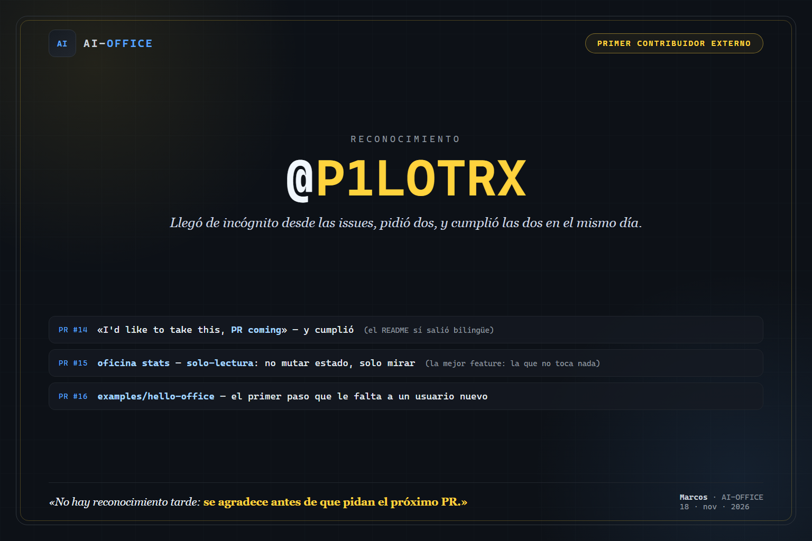

# Reconocimientos

AI-OFFICE crece por confianza, no por marketing. Esta lista no son benchmarks: es quién apareció y tiró del carro sin que nadie lo pidiera.

## Primer contribuidor externo

### @P1LOTRX — 18 de noviembre de 2026

Llegó desde las issues, dijo «PR coming», y cumplió las dos el mismo día:

| PR | Qué | Huella |
|---|---|---|
| #14 | `docs: add an English summary` | README bilingüe desde entonces |
| #15 | `feat: add oficina stats` | 100 % solo lectura, con tests propios |
| #16 | `docs: examples/hello-office` | La primera corrida de cualquier usuario nuevo |

Con ello: el proyecto demostró que un solo founder puede recibir contribuciones reales, sin pagar y sin prometer. Gracias.

## ¿Querés ser vos el siguiente?

Todas las puertas están en [CONTRIBUTING.md](CONTRIBUTING.md). Mirá las issues con label `good first issue` — son tareas chicas y bien acotadas. Si resolvés una, el muro te espera acá.
