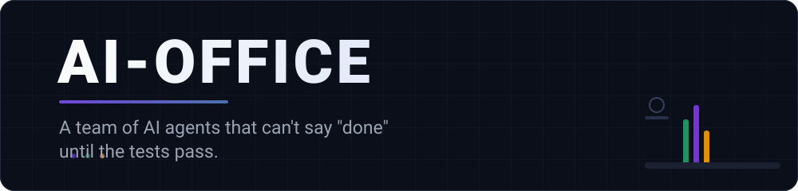
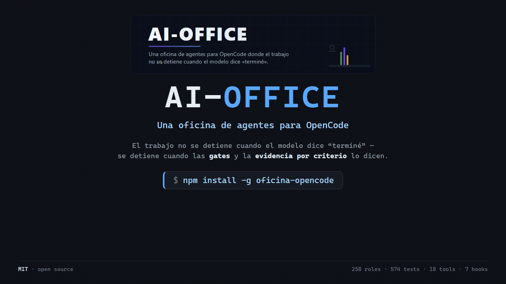
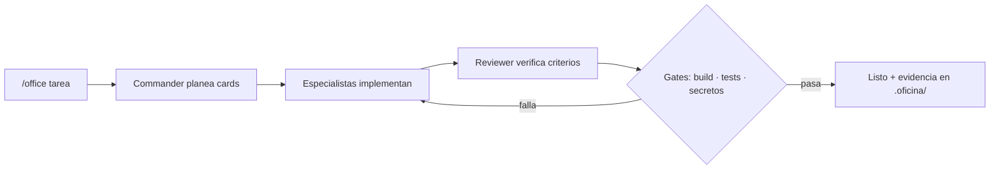

<div align="center">



<br>

# AI-OFFICE

### Tu agente de IA dice "listo". AI-OFFICE lo obliga a demostrarlo.

Un equipo de agentes de IA que **no puede** cerrar una tarea hasta que build, tests y gates de seguridad pasen de verdad — con evidencia guardada en disco.

Funciona con Claude Code, Codex, Cursor, Gemini CLI y OpenCode.

[](https://www.npmjs.com/package/ai-office-cli)
[](https://github.com/SOCRAMbt/AI-OFFICE/actions/workflows/ci.yml)
[](LICENSE)
[](https://github.com/SOCRAMbt/AI-OFFICE/stargazers)
[](https://nodejs.org)

[English](README.md) · **Español** · [Demo en vivo](https://socrambt.github.io/AI-OFFICE/)

<br>



</div>

---

## Inicio rápido

```bash
npx ai-office install        # detecta tu agente e instala AI-OFFICE
```

Después, dentro de tu agente:

```
/office agregar validación de entrada al formulario de registro
```

Se abre un dashboard en vivo en `localhost:7333`. Ninguna tarea se pone verde hasta que sus gates pasen.

---

## Agentes compatibles

| Agente | Estado | Cómo se integra |
|---|---|---|
| **OpenCode** | ✅ Estable | Plugin nativo |
| **Claude Code** | 🧪 Beta | Plugin + servidor MCP |
| **Codex** | 🧪 Beta | Servidor MCP (`config.toml`) |
| **Cursor** | 🧪 Beta | Servidor MCP (`.cursor/mcp.json`) |
| **Gemini CLI** | 🧪 Beta | Extensión |
| **Cualquier agente** | ✅ | Skill `proof-of-done` (solo instrucciones) |

<details>
<summary><b>OpenCode</b></summary>

```bash
npx ai-office install --platform opencode
```
Reiniciá OpenCode y ejecutá `/office <tarea>`.
</details>

<details>
<summary><b>Claude Code</b></summary>

```bash
claude plugin marketplace add SOCRAMbt/AI-OFFICE
claude plugin install ai-office
```
Ejecutá `/office <tarea>` en cualquier sesión.
</details>

<details>
<summary><b>Codex</b></summary>

```bash
codex mcp add ai-office -- npx -y ai-office-mcp
```
Después pedí: "usá ai-office para agregar validación de entrada…"
</details>

<details>
<summary><b>Cursor</b></summary>

Agregá a `.cursor/mcp.json`:
```json
{ "mcpServers": { "ai-office": { "command": "npx", "args": ["-y", "ai-office-mcp"] } } }
```
</details>

<details>
<summary><b>Gemini CLI</b></summary>

```bash
gemini extensions install https://github.com/SOCRAMbt/AI-OFFICE
```
</details>

<details>
<summary><b>Solo la skill (cualquier agente)</b></summary>

```bash
npx skills add SOCRAMbt/AI-OFFICE --skill proof-of-done
```
Liviano: solo reglas, sin dashboard ni motor de gates.
</details>

---

## Cómo funciona



- **Commander** divide el objetivo en cards pequeñas y elige especialistas de un catálogo de 258 roles.
- **Reviewer ≠ implementador**: un agente distinto verifica cada card contra sus criterios de aceptación.
- **Los gates son comandos, no opiniones**: código de salida 0 o la card vuelve.
- **Evidencia por criterio** se guarda en `.oficina/artifacts/`, para auditar cada "listo".

---

## ¿Por qué no un solo agente?

| | Un solo agente | AI-OFFICE |
|---|---|---|
| Dice "listo" cuando los tests fallan | Frecuente | Bloqueado por los gates |
| Revisión independiente | No | Obligatoria |
| Rastro de auditoría | Historial del chat | Archivos de evidencia por criterio |
| Costo en tokens | 1× | ~2–3× (seamos honestos) |

---

## Comandos

| Comando | Qué hace |
|---|---|
| `/office <tarea>` | Corrida completa con equipo |
| `/office lite <tarea>` | Un implementador + un reviewer |
| `/office --maxagents 2 <tarea>` | Limita el tamaño del equipo |
| `ai-office demo` | Dashboard con una corrida grabada, sin agente |
| `ai-office report` | Reporte compartible de la última corrida |

---

## Preguntas frecuentes

<details>
<summary><b>¿Funciona offline / con modelos locales?</b></summary>

Sí. AI-OFFICE es agnóstico al modelo: orquesta el agente que le apuntes. Los modelos locales funcionan siempre que el agente soporte tool calls.
</details>

<details>
<summary><b>¿Cuánto más cuesta en tokens?</b></summary>

Aproximadamente 2–3× una corrida de un solo agente, por el pase del reviewer y los reintentos de gates. El modo `/office lite` se acerca a 1.5×.
</details>

<details>
<summary><b>¿Se envía mi código a algún lado?</b></summary>

No. Todo corre localmente. Las únicas llamadas de red son las que tu agente ya hace a su proveedor de LLM.
</details>

<details>
<summary><b>¿Qué lenguajes y frameworks soporta?</b></summary>

Cualquiera. AI-OFFICE no se mete con tu stack: ejecuta tus comandos de build y test y verifica los códigos de salida.
</details>

---

## Hoja de ruta

- [x] Motor core: máquina de estados, cards, gates, bus, leases, recuperación
- [x] Plugin nativo de OpenCode (estable)
- [x] 6 adaptadores host (Claude Code, Codex, Cursor, Gemini, Grok, OpenCode)
- [x] CLI unificada con auto-detección
- [ ] Servidor MCP (`@ai-office/mcp`) — una sola implementación para todos los agentes
- [ ] Plugins nativos para Claude Code, Gemini CLI, Codex, Cursor
- [ ] Mejoras del dashboard y streaming de gates en tiempo real
- [ ] Suite de benchmarks con resultados reales (no simulados)

---

## Contribuir

Bugs e ideas → [issues](https://github.com/SOCRAMbt/AI-OFFICE/issues) · Setup de desarrollo → [DEVELOPING.md](DEVELOPING.md)

Good first issues → [label](https://github.com/SOCRAMbt/AI-OFFICE/labels/good%20first%20issue)

---

<div align="center">
<sub>MIT · Hecho en Buenos Aires · <a href="docs/ARCHITECTURE.md">Arquitectura</a> · <a href="SECURITY.md">Seguridad</a> · <a href="docs/GARANTIAS.md">Garantías</a></sub>
</div>
