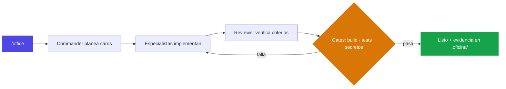

<div align="center">

<picture>
  <source media="(prefers-color-scheme: dark)" srcset="docs/assets/banner-dark.svg">
  <source media="(prefers-color-scheme: light)" srcset="docs/assets/banner-light.svg">
  
</picture>

<br>

# AI-OFFICE

### Tu agente de IA dice "listo". AI-OFFICE lo obliga a demostrarlo.

> Un orquestador multi-agente donde **ninguna tarea se cierra hasta que build, tests y gates de seguridad pasen de verdad** — con evidencia guardada en disco.

[](https://www.npmjs.com/package/ai-office-cli)
[](https://github.com/SOCRAMbt/AI-OFFICE/actions/workflows/ci.yml)
[](LICENSE)
[](https://github.com/SOCRAMbt/AI-OFFICE/stargazers)
[](https://nodejs.org)

<br>

[Inicio rápido](#inicio-rápido) · [Cómo funciona](#cómo-funciona) · [Compatibilidad](#agentes-compatibles) · [¿Por qué AI-OFFICE?](#por-qué-no-un-solo-agente) · [Hoja de ruta](#hoja-de-ruta)

<br>

<picture>
  <source media="(prefers-color-scheme: dark)" srcset="docs/assets/demo-dark.gif">
  <source media="(prefers-color-scheme: light)" srcset="docs/assets/demo-light.gif">
  
</picture>

<sub>↑ El agente dice "listo" → el gate de tests falla → el equipo lo arregla → el gate pasa → evidencia guardada</sub>

</div>

<br>

---

<br>

## Inicio rápido

```bash
npx ai-office install        # detecta tu agente e instala AI-OFFICE
```

Después, dentro de tu agente:

```
/office agregar validación de entrada al formulario de registro
```

Se abre un dashboard en vivo en `localhost:7333`. **Ninguna tarea se pone verde hasta que sus gates pasen.**

---

## Agentes compatibles

| Agente | Estado | Cómo se integra |
|:---|:---:|:---|
| **OpenCode** | ✅ Estable | Plugin nativo |
| **Claude Code** | 🧪 Beta | Plugin + servidor MCP |
| **Codex** | 🧪 Beta | Servidor MCP (`config.toml`) |
| **Cursor** | 🧪 Beta | Servidor MCP (`.cursor/mcp.json`) |
| **Gemini CLI** | 🧪 Beta | Extensión |
| **Cualquier agente** | ✅ | Skill `proof-of-done` (solo instrucciones) |

<details>
<summary><b>OpenCode</b> — plugin nativo, cero config</summary>

```bash
npx ai-office install --platform opencode
```
Reiniciá OpenCode y ejecutá `/office <tarea>`.
</details>

<details>
<summary><b>Claude Code</b> — marketplace + MCP</summary>

```bash
claude plugin marketplace add SOCRAMbt/AI-OFFICE
claude plugin install ai-office
```
Ejecutá `/office <tarea>` en cualquier sesión.
</details>

<details>
<summary><b>Codex</b> — MCP en config.toml</summary>

```bash
codex mcp add ai-office -- npx -y ai-office-mcp
```
Después pedí: *"usá ai-office para agregar validación de entrada…"*
</details>

<details>
<summary><b>Cursor</b> — MCP en .cursor/mcp.json</summary>

Agregá a `.cursor/mcp.json`:
```json
{ "mcpServers": { "ai-office": { "command": "npx", "args": ["-y", "ai-office-mcp"] } } }
```
</details>

<details>
<summary><b>Gemini CLI</b> — instalación de extensión</summary>

```bash
gemini extensions install https://github.com/SOCRAMbt/AI-OFFICE
```
</details>

<details>
<summary><b>Solo la skill</b> — cualquier agente, sin dashboard</summary>

```bash
npx skills add SOCRAMbt/AI-OFFICE --skill proof-of-done
```
Liviano: solo reglas, sin dashboard ni motor de gates.
</details>

---

## Cómo funciona



| Rol | Qué hace |
|:---|:---|
| **Commander** | Divide el objetivo en cards pequeñas y elige especialistas de un catálogo de 258 roles |
| **Especialistas** | Implementan dentro de un scope estricto — una card, un agente, un artefacto |
| **Reviewer** | Un agente *distinto* verifica cada card contra sus criterios de aceptación |
| **Gates** | Comandos reales (`npm test`, `tsc`, escaneo de secretos) — código de salida 0 o la card vuelve |
| **Evidencia** | Cada criterio obtiene prueba guardada en `.oficina/artifacts/` |

---

## ¿Por qué no un solo agente?

| | Un solo agente | AI-OFFICE |
|:---|:---|:---|
| Dice "listo" cuando los tests fallan | Frecuente | **Bloqueado por los gates** |
| Revisión independiente | No | **Obligatoria** |
| Rastro de auditoría | Historial del chat | **Archivos de evidencia por criterio** |
| Enforce de scope | Sistema de honor | **El guard rechaza escrituras fuera de scope** |
| Costo en tokens | 1× | ~2–3× (seamos honestos) |

---

## Qué obtenés

| Funcionalidad | Descripción |
|:---|:---|
| 🎯 **Commander** | Descompone objetivos en cards verificables con criterios de aceptación |
| 🔍 **Revisión independiente** | Reviewer ≠ implementador — enforced por el motor |
| ⚡ **Quality gates** | Build, typecheck, lint, tests, secretos, diff — códigos de salida reales |
| 📋 **Grafo de evidencia** | Cada criterio necesita prueba antes de que una card pueda cerrarse |
| 🛡️ **Guard de scope** | Los agentes no pueden escribir fuera de sus archivos autorizados |
| 💬 **Bus de mensajes** | Los agentes piden ayuda, declinan y coordinan en disco |
| 📊 **Dashboard en vivo** | Vista en tiempo real de cards, agentes, gates y costo |
| 💰 **Tracking de costo** | Tokens y USD por card, agente y fase |
| 🔄 **Recuperación** | Reanudar después de un crash — estado persistido en `.oficina/` |
| 🧪 **Skill proof-of-done** | Versión liviana para cualquier agente, sin dashboard |

---

## Comandos

| Comando | Qué hace |
|:---|:---|
| `/office <tarea>` | Corrida completa con equipo |
| `/office lite <tarea>` | Un implementador + un reviewer |
| `/office --maxagents 2 <tarea>` | Limita el tamaño del equipo |
| `ai-office demo` | Dashboard con una corrida grabada, sin agente |
| `ai-office report` | Reporte compartible de la última corrida |

---

## Preguntas frecuentes

<details>
<summary><b>¿Funciona offline / con modelos locales?</b></summary>

Sí. AI-OFFICE es agnóstico al modelo: orquesta el agente que le apuntes. Los modelos locales funcionan siempre que el agente soporte tool calls.
</details>

<details>
<summary><b>¿Cuánto más cuesta en tokens?</b></summary>

Aproximadamente 2–3× una corrida de un solo agente, por el pase del reviewer y los reintentos de gates. El modo `/office lite` se acerca a 1.5×.
</details>

<details>
<summary><b>¿Se envía mi código a algún lado?</b></summary>

No. Todo corre localmente. Las únicas llamadas de red son las que tu agente ya hace a su proveedor de LLM.
</details>

<details>
<summary><b>¿Qué lenguajes y frameworks soporta?</b></summary>

Cualquiera. AI-OFFICE no se mete con tu stack: ejecuta tus comandos de build y test y verifica los códigos de salida.
</details>

<details>
<summary><b>¿Puedo usarlo sin instalar nada?</b></summary>

Sí. La skill `proof-of-done` es un conjunto de reglas que podés soltar en el contexto de cualquier agente. Sin dashboard, sin motor de gates — solo la disciplina.
</details>

---

## Hoja de ruta

- [x] Motor core: máquina de estados, cards, gates, bus, leases, recuperación
- [x] Plugin nativo de OpenCode (estable)
- [x] 6 adaptadores host (Claude Code, Codex, Cursor, Gemini, Grok, OpenCode)
- [x] CLI unificada con auto-detección
- [x] Grafo de evidencia por criterio de aceptación
- [x] Tracking de costo y enforce de presupuesto
- [ ] Servidor MCP (`@ai-office/mcp`) — una sola implementación para todos los agentes
- [ ] Plugins nativos para Claude Code, Gemini CLI, Codex, Cursor
- [ ] Mejoras del dashboard y streaming de gates en tiempo real
- [ ] Suite de benchmarks con resultados reales (no simulados)

---

## Contribuir

Bugs e ideas → [issues](https://github.com/SOCRAMbt/AI-OFFICE/issues) · Setup de desarrollo → [DEVELOPING.md](DEVELOPING.md)

Good first issues → [label](https://github.com/SOCRAMbt/AI-OFFICE/labels/good%20first%20issue)

---

<div align="center">
<sub>MIT · Hecho en Buenos Aires · <a href="docs/ARCHITECTURE.md">Arquitectura</a> · <a href="SECURITY.md">Seguridad</a> · <a href="docs/GARANTIAS.md">Garantías</a></sub>
</div>
