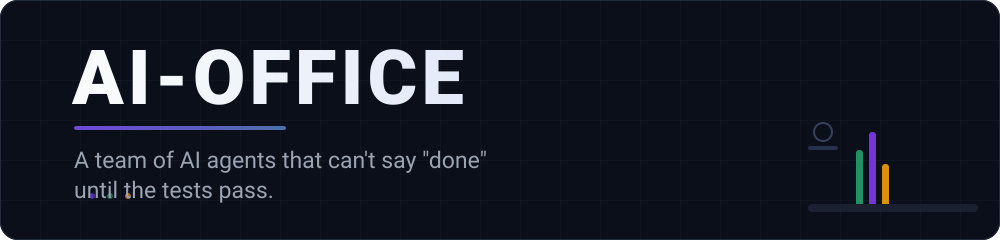

<div align="center">



<br>

# AI-OFFICE

**Your AI agent says "done". AI-OFFICE makes it prove it.**

[](https://www.npmjs.com/package/oficina-opencode)
[](https://github.com/SOCRAMbt/oficina-opencode/actions/workflows/ci.yml)
[](LICENSE)

</div>

---

## What it does

You type `/office <task>` in OpenCode. A **Commander** agent assembles a team of specialist subagents from a catalog of 258 roles across 18 divisions, coordinates them via a message bus on disk, and **no task closes until real tests pass**.

Every "done" claim is backed by evidence: build output, test results, secret scans — saved in `.oficina/`.

## Quickstart

```bash
npm install -g oficina-opencode
```

Then in OpenCode:

```
/office "add input validation to the signup form"
```

The dashboard opens at `http://localhost:7333` with a live view of agents working, gates turning green, and evidence being collected.

## What you'll see

- **Red → Green**: Agent says "done" → gate fails (red) → team fixes → gate passes (green)
- **Evidence**: Every acceptance criterion has a file with proof
- **No silent failures**: 11 locations where errors were swallowed are now logged

## Install the lightweight skill

No OpenCode? Use the skill version:

```bash
npx skills add SOCRAMbt/oficina-opencode
```

Works with Claude Code, Codex, Cursor, and OpenCode.

## Why not just use one agent?

One agent says "done" and moves on. AI-OFFICE requires:
- A **reviewer** that checks the work against acceptance criteria
- A **verifier** that runs real gates (build, tests, security)
- **Evidence** saved per criterion

The agent can't close a task until all three pass.

<!-- BEGIN GENERATED: facts -->
| | |
|---|---|
| **Paquete** | `oficina-opencode` v4.0.0 |
| **Tools** | 18 |
| **Hooks** | 7 |
| **API de plugin** | `@opencode/plugin@2.3.2` |
| **Node** | >=22 |
| **Catálogo** | 258 agentes resolubles en 18 divisiones |
| **Divisiones** | academic, design, engineering, finance, game-development, gis, healthcare, marketing, paid-media, product, project-management, research, sales, spatial-computing, specialized, strategy, support, testing |
<!-- Catalog source: agency-agents @ 4e3ac3c -->
<!-- END GENERATED: facts -->

## Documentation

- [Architecture](docs/ARCHITECTURE.md)
- [Guarantees](docs/GARANTIAS.md)
- [E2E Test](docs/PRUEBA-E2E.md)
- [Compatibility](docs/COMPATIBILITY.md)

## Español

[README en español](README.es.md)

---

*AI-OFFICE: your AI agent says "done". AI-OFFICE makes it prove it.*
