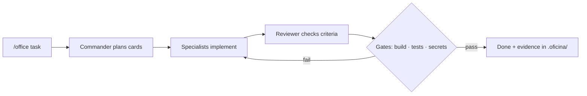

<div align="center">


<br>

# AI-OFFICE

### Your AI agent says "done". AI-OFFICE makes it prove it.

A team of AI agents that **cannot** close a task until build, tests and security gates actually pass — with evidence saved on disk.

Works with Claude Code, Codex, Cursor, Gemini CLI and OpenCode.

[](https://www.npmjs.com/package/ai-office-cli)
[](https://github.com/SOCRAMbt/AI-OFFICE/actions/workflows/ci.yml)
[](LICENSE)
[](https://github.com/SOCRAMbt/AI-OFFICE/stargazers)
[](https://nodejs.org)

**English** · [Español](README.es.md) · [Live demo](https://socrambt.github.io/AI-OFFICE/)

<br>


</div>

---

## Quickstart

```bash
npx ai-office install        # detects your agent and installs AI-OFFICE
```

Then, inside your agent:

```
/office add input validation to the signup form
```

A live dashboard opens at `localhost:7333`. No task turns green until its gates pass.

---

## Supported agents

| Agent | Status | How it plugs in |
|---|---|---|
| **OpenCode** | ✅ Stable | Native plugin |
| **Claude Code** | 🧪 Beta | Plugin + MCP server |
| **Codex** | 🧪 Beta | MCP server (`config.toml`) |
| **Cursor** | 🧪 Beta | MCP server (`.cursor/mcp.json`) |
| **Gemini CLI** | 🧪 Beta | Extension |
| **Any agent** | ✅ | `proof-of-done` skill (instructions only) |

<details>
<summary><b>OpenCode</b></summary>

```bash
npx ai-office install --platform opencode
```
Restart OpenCode and run `/office <task>`.
</details>

<details>
<summary><b>Claude Code</b></summary>

```bash
claude plugin marketplace add SOCRAMbt/AI-OFFICE
claude plugin install ai-office
```
Run `/office <task>` in any session.
</details>

<details>
<summary><b>Codex</b></summary>

```bash
codex mcp add ai-office -- npx -y ai-office-mcp
```
Then ask: "use ai-office to add input validation…"
</details>

<details>
<summary><b>Cursor</b></summary>

Add to `.cursor/mcp.json`:
```json
{ "mcpServers": { "ai-office": { "command": "npx", "args": ["-y", "ai-office-mcp"] } } }
```
</details>

<details>
<summary><b>Gemini CLI</b></summary>

```bash
gemini extensions install https://github.com/SOCRAMbt/AI-OFFICE
```
</details>

<details>
<summary><b>Just the skill (any agent)</b></summary>

```bash
npx skills add SOCRAMbt/AI-OFFICE --skill proof-of-done
```
Lightweight: rules only, no dashboard or gates engine.
</details>

---

## How it works



- **Commander** splits the goal into small cards and picks specialists from a 258-role catalog.
- **Reviewer ≠ implementer**: a different agent checks every card against its acceptance criteria.
- **Gates are commands, not opinions**: exit code 0 or the card goes back.
- **Evidence per criterion** is saved to `.oficina/artifacts/`, so you can audit every "done".

---

## Why not just one agent?

| | Single agent | AI-OFFICE |
|---|---|---|
| Says "done" when tests fail | Often | Blocked by gates |
| Independent review | No | Required |
| Audit trail | Chat history | Evidence files per criterion |
| Token cost | 1× | ~2–3× (be honest) |

---

## Commands

| Command | What it does |
|---|---|
| `/office <task>` | Full team run |
| `/office lite <task>` | One implementer + one reviewer |
| `/office --maxagents 2 <task>` | Cap the team size |
| `ai-office demo` | Dashboard with a recorded run, no agent needed |
| `ai-office report` | Shareable report card of the last run |

---

## FAQ

<details>
<summary><b>Does it work offline / with local models?</b></summary>

Yes. AI-OFFICE is model-agnostic — it orchestrates whatever agent you point it at. Local models work as long as the agent supports tool calls.
</details>

<details>
<summary><b>How much more does it cost in tokens?</b></summary>

Roughly 2–3× a single-agent run, because of the reviewer pass and gate retries. The `/office lite` mode keeps it closer to 1.5×.
</details>

<details>
<summary><b>Is my code sent anywhere?</b></summary>

No. Everything runs locally. The only network calls are the ones your agent already makes to its LLM provider.
</details>

<details>
<summary><b>What languages and frameworks does it support?</b></summary>

Any. AI-OFFICE doesn't care about your stack — it runs your build and test commands and checks the exit codes.
</details>

---

## Roadmap

- [x] Core engine: state machine, cards, gates, bus, leases, recovery
- [x] OpenCode native plugin (stable)
- [x] 6 host adapters (Claude Code, Codex, Cursor, Gemini, Grok, OpenCode)
- [x] Unified CLI with auto-detect
- [ ] MCP server (`@ai-office/mcp`) — single implementation for all agents
- [ ] Native plugins for Claude Code, Gemini CLI, Codex, Cursor
- [ ] Dashboard improvements and real-time gate streaming
- [ ] Benchmark suite with real (non-simulated) results

---

## Contributing

Bugs and ideas → [issues](https://github.com/SOCRAMbt/AI-OFFICE/issues) · Dev setup → [DEVELOPING.md](DEVELOPING.md)

Good first issues → [label](https://github.com/SOCRAMbt/AI-OFFICE/labels/good%20first%20issue)

---

<div align="center">
<sub>MIT · Built in Buenos Aires · <a href="docs/ARCHITECTURE.md">Architecture</a> · <a href="SECURITY.md">Security</a> · <a href="docs/GARANTIAS.md">Guarantees</a></sub>
</div>
